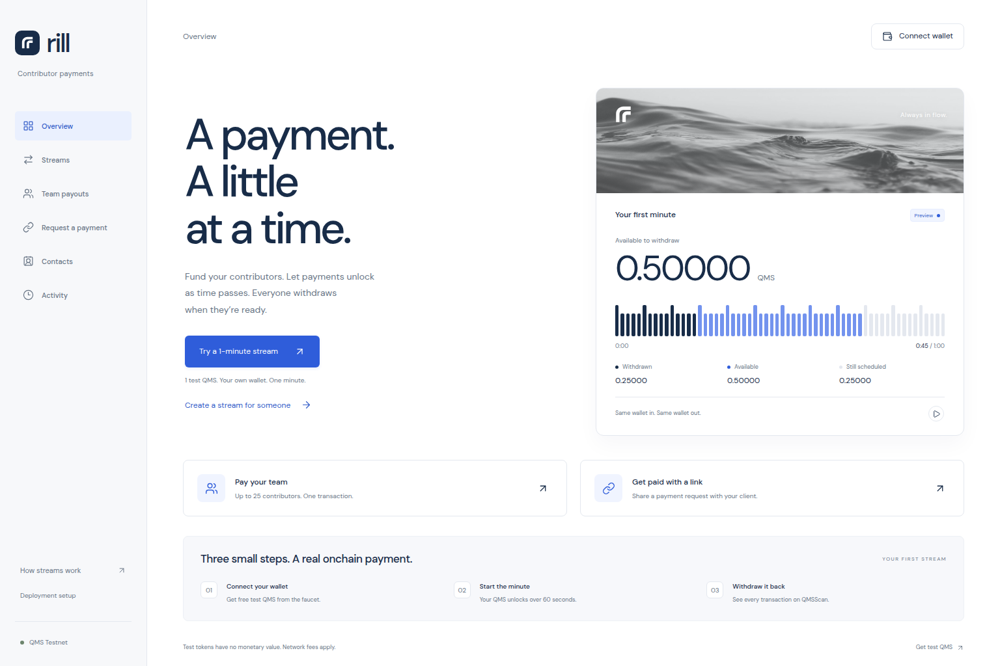

# Rill

Contributor payments on QMS. Fund your team in one transaction, share payment requests, and let each recipient withdraw as their payment unlocks.

[Open Rill](https://rill-sepia.vercel.app/) · [Selected Precision design](design/concepts/README.md#b--precision-fintech)

**V2 is deployed on QMS Testnet with source and ABI verified on QMSScan.** The example configuration selects this deployment, including named streams and atomic contributor payouts. QMSScan labels verification **partial match** because compiler metadata was omitted; the complete creation and runtime bytecode match the compiled source exactly. [Builder submission notes and 90-day plan](docs/builder-program.md).

[V2 contract on QMSScan](https://testnet.qmsscan.io/address/0xC53B89bd7e67B8cC6bdbae64E068F6710C719Efc?tab=contract) · [Testnet faucet](https://faucet.testnet.qms.finance) · [Verification notes](docs/rill-verification.md)



## What you can do

- See a complete wallet overview: withdrawable QMS, incoming schedules, outgoing commitments, active streams, a seven-day release forecast, and upcoming endings.
- Create **up to 25 contributor streams in one atomic transaction**, using editable rows or a CSV (`recipient,amount,name`). **V2 required.**
- Give streams public onchain names. **V2 required.**
- Create shareable payment requests with recipient, exact amount, duration, and optional name. The payer reviews and signs; generating the link needs no transaction.
- Save wallet-specific contacts in your browser and use weekly-contributor or monthly-retainer presets.
- Create a payment stream lasting **60 seconds to 365 days**.
- Withdraw accrued QMS as the recipient, or cancel an unfinished stream as the sender.
- Try a **one-minute stream of 1 test QMS to your own wallet**. Network fees are separate.
- Browse incoming and outgoing streams, balances, and transaction history.
- Connect an injected EVM wallet, switch to QMS Testnet, and review fees before signing.
- Resume pending transaction tracking after a page refresh.

Rill is a static React app backed by an immutable Solidity contract. It uses native QMS, so token approvals are unnecessary. The contract has no administrator, upgrade mechanism, or protocol fee. All connected views read chain data; the first-visit example is labeled as a preview.

## V2 deployment

| Field           | Value                                                                                                                                      |
| --------------- | ------------------------------------------------------------------------------------------------------------------------------------------ |
| Network         | QMS Testnet                                                                                                                                |
| Chain ID        | `19480` (`0x4c18`)                                                                                                                         |
| Native currency | QMS, 18 decimals                                                                                                                           |
| RPC             | `https://rpc.testnet.qms.finance`                                                                                                          |
| Contract        | [`0xC53B89bd7e67B8cC6bdbae64E068F6710C719Efc`](https://testnet.qmsscan.io/address/0xC53B89bd7e67B8cC6bdbae64E068F6710C719Efc?tab=contract) |
| Deployment      | [Transaction on QMSScan](https://testnet.qmsscan.io/tx/0x2a6503b70c60216aaf64ec7ed6a00abaa074d523d3835690b51d15ca6be60f07)                 |
| Source          | [`contracts/RillStream.sol`](contracts/RillStream.sol)                                                                                     |

Source and ABI are published on QMSScan. The explorer reports **verified (partial match)** because the build omits compiler metadata. Both creation and runtime bytecode were independently compared with the compiled artifact and match exactly. See [compiler settings and verification evidence](docs/rill-verification.md#v2-deployment-and-explorer-verification).

The original [V1 deployment](https://testnet.qmsscan.io/address/0x5AB83339041a650214D7D1086c4f8dD428701BCE?tab=contract) remains supported, with its source archived at commit `18f0100`. The client accepts both known runtime hashes and only enables V2 calls on V2 contracts. Old funds remain at the original address; the V2 deployment does not migrate balances.

Expected V2 runtime hash: `0xc1ac6dc9a1118b881e5066ce04c339dbc7f9592953e29dfc9c6b408e04942b20`.

## Quick start

Use **Node.js 24**, npm, and an EVM browser wallet for transactions. Browsing the first-visit screen does not require a wallet.

```bash
git clone --branch main https://github.com/qFloppa/qms-payment-streaming.git
cd qms-payment-streaming
npm ci
cp .env.example .env.local
npm run dev
```

Open the URL Vite prints, normally `http://localhost:5173`, in a browser on the machine running the app. The repository is private, so cloning requires GitHub access.

The example environment selects the deployed QMS Testnet contract. Connect your wallet, switch to QMS Testnet, and get test QMS from the [faucet](https://faucet.testnet.qms.finance). The one-minute trial needs **1 QMS plus the network fee**.

### Configuration

| Variable                       | Purpose                                                                   |
| ------------------------------ | ------------------------------------------------------------------------- |
| `VITE_STREAM_CONTRACT_ADDRESS` | Contract used by this build; the example contains the deployment above.   |
| `VITE_LOCAL_DEVELOPMENT`       | Set to `true` only for a local development chain.                         |
| `VITE_RPC_URL`                 | Loopback RPC URL required in local mode, such as `http://127.0.0.1:8545`. |
| `VITE_CHAIN_ID`                | Local chain ID; defaults to `31337` in local mode.                        |

Outside local mode, the app always uses QMS Testnet and its configured public RPC.

A `?contract=0x…` query parameter overrides the build configuration. Otherwise, the app uses a nonempty environment address, then the address saved for that chain in browser storage. Put the query **before** the hash route, for example:

```text
http://localhost:5173/?contract=0xC53B89bd7e67B8cC6bdbae64E068F6710C719Efc#/
```

Every selected address must match a supported Rill runtime hash before fund transactions are enabled. Restart Vite after changing `.env.local`; rebuild a hosted site after changing its build environment. All `VITE_*` values are public client configuration.

## Build and host

```bash
npm run build
npm run preview
```

The production build is in `dist/`. Deploy that directory to an HTTPS static host, using **`npm ci && npm run build`** as the build command and **`dist`** as the output directory. Set `VITE_STREAM_CONTRACT_ADDRESS` to the deployed address in the host's build environment.

Hash routes and relative assets support static hosting and subdirectories without server-side routing. No application server, database, or private key is required to host Rill. Localhost URLs refer to the device opening them; an app running on a VPS needs a hosted HTTPS address or tunnel for remote visitors.

## How streams work

The sender deposits the full amount when creating a stream. QMS unlocks linearly from its start time to its end time. Only the recipient can withdraw, and each withdrawal transfers the unlocked amount that has not already been claimed.

Before completion, the sender can cancel. Cancellation returns the still-scheduled amount to the sender and preserves the recipient's already-unlocked entitlement. Completion releases any rounding remainder.

The contract uses integer accounting and guards all fund entry points against reentrancy. A failed transfer reverts the associated accounting. The interface estimates fees, rechecks wallet and chain context before sending, and tracks confirmation separately from submission. Pending receipts, replacements, and declined signatures have distinct states.

The overview and stream filters read every wallet stream at one block, with bounded concurrent requests. Lists display 20 items at a time. Forecasts show future release under the currently funded schedules; they do not imply automatic wallet transfers. Self streams are included in withdrawable balances but excluded from incoming/outgoing commitments and the forecast. Activity loads in 2,000-block ranges with a control for earlier history. Wallet discovery supports EIP-6963 and injected EIP-1193 providers.

Stream names are public and limited to 80 UTF-8 bytes. Contacts stay in the current browser, scoped to wallet and chain; they are not shared with recipients. Request links contain unsigned, editable terms, not proof of identity or payment. Rill does not track an invoice as paid: confirmed streams and transaction receipts are the payment record.

V2 batches fund all rows or revert the entire transaction. Each resulting stream has the original wallet as sender, its own recipient and schedule, and independent withdrawal/cancellation controls. No batch intermediary owns the funds. Refresh recovery checks the exact submitted calldata and value before reporting a new transaction as confirmed.

## Development and tests

```bash
npm test                 # domain arithmetic and wallet lifecycle
npm run test:contracts   # compile Solidity and run contracts on disposable Anvil
npm run typecheck        # TypeScript
npm run build            # production build, including a type check
npm run test:e2e         # browser flows with Anvil and a test-only wallet
```

Tests cover accrual, cancellation, rounding, authorization, reentrancy, transfer failures, atomic batches, public names, CSV/request validation, more than 100 wallet streams, V1 compatibility, wallet/network changes, batch receipt recovery, and deployment verification. [GitHub Actions](https://github.com/qFloppa/qms-payment-streaming/actions/workflows/ci.yml) runs these checks and ensures generated contract files match the source.

Anvil is installed through npm. Browser tests use Chrome at `/opt/google/chrome/chrome` if available. Otherwise, install Chromium:

```bash
npx playwright install --with-deps chromium
```

You can also set `CHROME_PATH` to an existing browser executable. The browser harness starts its own chain and Vite server; **port 4173 must be free**. Tests use disposable accounts and do not need a real wallet. Screenshots and failure traces are written to `/tmp/qms-qa`.

### Local chain

Run `npm run chain` in another terminal, then set these values in `.env.local` and restart Vite:

```dotenv
VITE_STREAM_CONTRACT_ADDRESS=
VITE_LOCAL_DEVELOPMENT=true
VITE_RPC_URL=http://127.0.0.1:8545
VITE_CHAIN_ID=31337
```

Configure a local wallet for that chain using a disposable Anvil account, remove any existing `?contract=…` query parameter, then deploy through `/#/setup`. Clearing the testnet contract address allows the app to use your local deployment. Local mode requires a loopback RPC.

### Deploy another contract

The published V2 deployment is ready to use. To create another instance:

1. Open `/#/setup`, connect your wallet, and select the intended network.
2. Fund the wallet with native currency for deployment fees.
3. Select **Review deployment**, then confirm in your wallet.
4. Wait for the receipt and runtime-code check, then copy the shareable URL.

The setup success panel explicitly confirms V2. The shareable URL selects the new address; configure `VITE_STREAM_CONTRACT_ADDRESS` and rebuild your hosted site to make it the default for other visitors. Existing V1 links continue to work. Separate deployments require their own explorer source verification with the current V2 compiler input/artifact.

An optional `npm run deploy` command accepts `RILL_RPC_URL` and `RILL_PRIVATE_KEY` through the local process environment. It defaults to QMS Testnet and rejects unexpected chains. Disposable unlocked Anvil accounts require `RILL_ALLOW_LOCAL_CHAIN=true` and `RILL_LOCAL_ACCOUNT` with a loopback RPC. Wallet keys belong only in the wallet or local process environment, never in `VITE_*` variables or committed files.

## Project structure

```text
contracts/             RillStream, test receivers, and compiled artifacts
scripts/               Compilation, deployment, local chain, and browser harness
src/components/        Shared UI, wallet dialogs, and transaction review
src/context/           Wallet-to-contract flow and receipt tracking
src/contracts/         Generated ABI, runtime hash, and deployment bytecode
src/hooks/             Wallet state and chain snapshots
src/lib/               Chain configuration, accounting, storage, and transactions
src/pages/             Home, streams, creation, details, activity, and setup
src/styles/            Layout, page, and dialog styles
tests/                 Unit, contract, and browser integration tests
design/                Approved designs, original explorations, and Pen source
docs/                  Specification, implementation plan, and verification notes
```

The frontend uses React, TypeScript, Vite, viem, and Lucide. Solidity is pinned to **0.8.38**, targeting **Paris**, with optimizer runs set to **200**. Rebuild generated contract files with `npm run contracts:compile`.

## Design and technical notes

The interface implements the selected **Precision** direction: white surfaces, navy DM Sans typography, blue actions, a double-channel “r” mark, and grayscale water photography. The same tokens style the dashboard, forms, stream records, and transaction dialogs. Original alternatives remain in the [concept gallery](design/concepts/README.md).

Short entrances, hover and press feedback, and timeline transitions respond to interaction. The illustrative first-minute preview advances from 45 to 60 seconds, supports pause/resume/replay, and suspends while offscreen or in a hidden tab. Reduced motion disables decorative animation and starts the preview paused. Actual payment balances remain chain-derived.

The bundled [water photograph](https://images.unsplash.com/photo-1518837695005-2083093ee35b) is from Unsplash and used under the [Unsplash license](https://unsplash.com/license).

- [Product brief](design/brief.md)
- [Interaction requirements](design/interaction-notes.md)
- [Precision reference](design/concepts/precision.html)
- [Precision implementation plan](docs/superpowers/plans/2026-11-10-precision-design.md)
- [Original editable Pen exploration](design/explorations.pen)
- [Implementation specification](docs/superpowers/specs/2026-11-09-rill-design.md)
- [Implementation and verification notes](docs/rill-verification.md)

## License

`RillStream.sol` declares the MIT license. A repository-wide license has not been specified.
