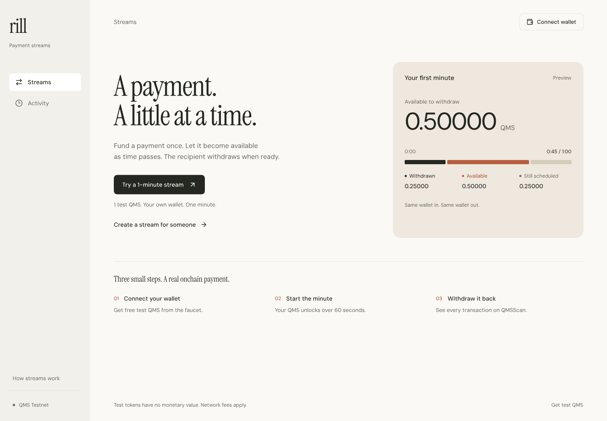
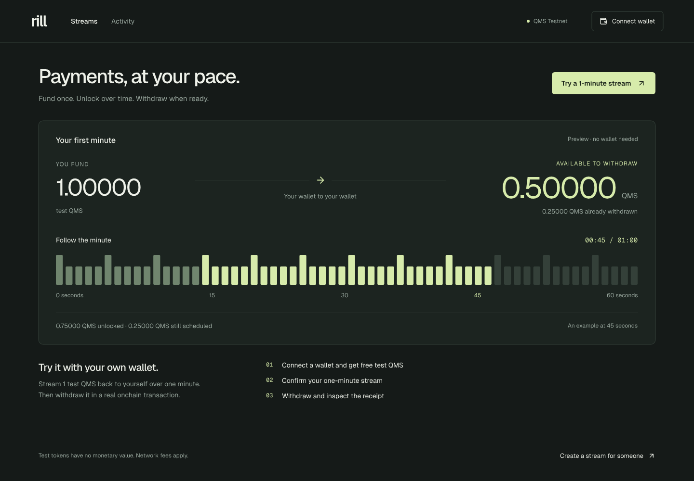
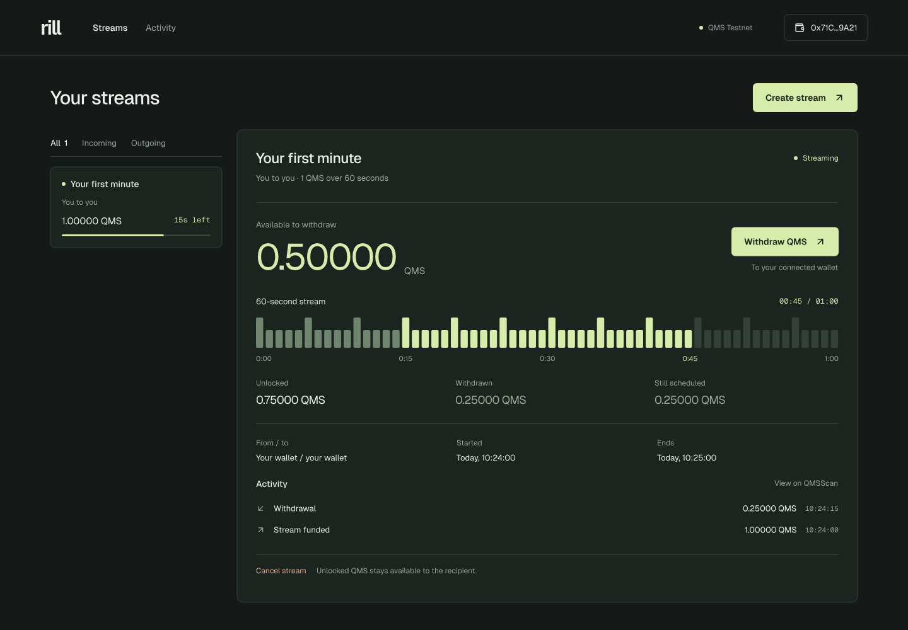
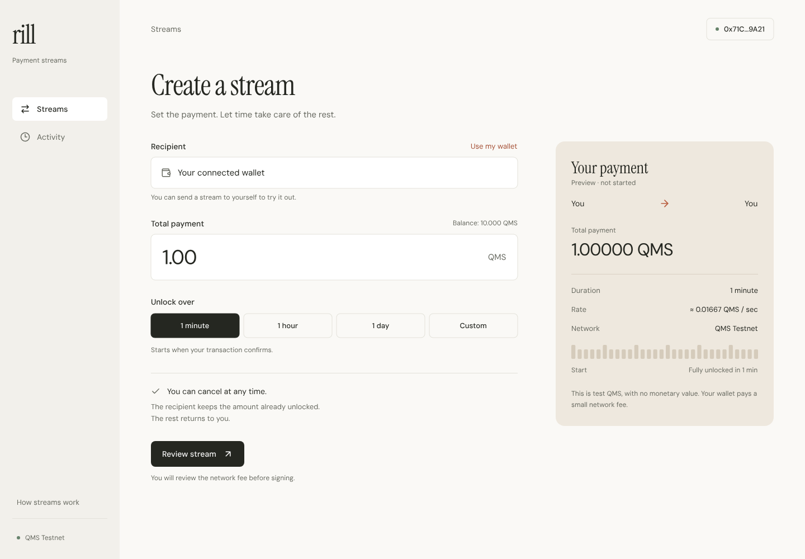
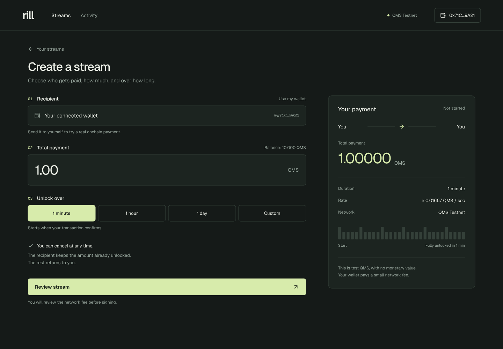
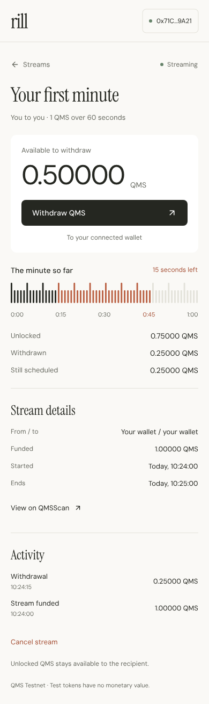
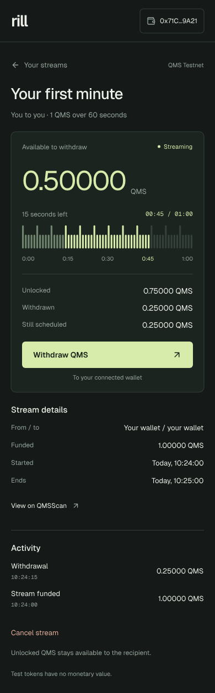

# Rill — payment streams

A working React app for native QMS payments that unlock over time. Direction A is implemented: create a stream, withdraw accrued QMS, cancel the remaining schedule, and inspect onchain activity on desktop or mobile.

The one-minute trial deposits **1 test QMS into a stream to your own wallet for 60 seconds**. Network fees are separate. All connected screens read the chain; the first-visit card is explicitly a preview.

## Run the app

Requires Node 24 and npm. From this checkout:

```bash
npm ci --cache /tmp/qms-npm-cache
npm run dev
```

Open the Vite URL (normally `http://localhost:5173`). `npm run build` produces the static site in `dist/`; `npm run preview` serves it locally. Hash routes and relative build assets support static hosting and subdirectories. Use HTTPS for a hosted app.

## QMS deployment status

**No QMS Testnet deployment has been made or claimed.** The contract and app are tested against real, disposable Anvil transactions. A funded browser wallet must sign the actual QMS deployment before normal users can create streams.

1. Open `/#/setup`, connect an EVM wallet, and switch to QMS Testnet.
2. Get test QMS from the [official faucet](https://faucet.testnet.qms.finance).
3. Select **Review deployment**, inspect the fee, then confirm in your wallet.
4. Wait for a successful receipt and runtime-code verification. Copy the shareable app URL, or set `VITE_STREAM_CONTRACT_ADDRESS` in `.env.local` and rebuild.

The setup route is separate from visitor navigation. Addresses from a URL `?contract=0x…`, the build environment, or local storage are checked against the compiled runtime hash before fund transactions. Missing and mismatched deployments are explicit errors. No private key is collected by the browser app.

| Network | Value |
| --- | --- |
| Chain | QMS Testnet, 19480 |
| RPC | `https://rpc.testnet.qms.finance` |
| Explorer | [QMSScan](https://testnet.qmsscan.io) |
| Currency | Native QMS, 18 decimals |

## Streams and transaction handling

- Streams accept positive deposits and durations from 60 seconds to 365 days. Only the recipient can withdraw and only the sender can cancel before completion.
- Cancellation refunds the still-scheduled amount. Previously unlocked QMS remains claimable by the recipient; completion releases all rounding dust.
- The contract is immutable, with no administrator or protocol fee. Failed transfers revert accounting; all fund entry points have a reentrancy guard.
- Displayed amounts use bigint arithmetic and one identified block timestamp. Network fees are estimated before signing; wallet, network, contract, and funds are rechecked before sending.
- Pending transaction hashes and their chain, contract, wallet, and action survive refresh. A receipt timeout remains pending. A reverted or cancelled transaction is not reported as successful. Keep the transaction hash if browser storage is unavailable.
- Stream discovery uses 20-item pages; incoming/outgoing filters apply to the current page. Activity queries cover 2,000 blocks at a time, with **Load earlier activity** for history.
- Wallet discovery supports EIP-6963 and injected EIP-1193 providers. Returning from the faucet refreshes chain data. Keys remain with the wallet.

## Local development and tests

```bash
npm test                 # amount/accounting and wallet lifecycle tests
npm run test:contracts   # deterministic compile + real Anvil transactions
npm run typecheck
npm run build
npm run test:e2e         # real Chrome/Chromium + an isolated Anvil + test-only wallet
```

Browser tests use Chrome at `/opt/google/chrome/chrome` when available. Otherwise run `npx playwright install --with-deps chromium`, or set `CHROME_PATH`. The harness starts and stops its own chain and Vite server; it needs port 4173 free. No real wallet or keys are needed. Screenshots and failure traces go to `/tmp/qms-qa`.

For manual local-chain development:

```bash
npm run chain
```

Copy `.env.example` to `.env.local`, enable `VITE_LOCAL_DEVELOPMENT=true`, set the loopback RPC and chain ID 31337, then use `/#/setup` with an explicitly configured local wallet. Production defaults always use QMS Testnet; a local override requires a loopback RPC. The deployed bytecode is dynamically loaded on setup.

An optional CLI is available via `npm run deploy`. It reads `RILL_RPC_URL` and a **local environment-only** `RILL_PRIVATE_KEY`; never commit or paste keys. It refuses unexpected chains. Disposable Anvil unlocked accounts require both `RILL_ALLOW_LOCAL_CHAIN=true` and `RILL_LOCAL_ACCOUNT`, with a loopback RPC. The CLI reports only the verified deployment address, receipt metadata, and runtime hash.

The overflow contract test seeds one extreme escrow fixture directly because Anvil’s transaction pool caps transaction cost at uint128, then executes the real deployed accounting and withdrawal. All ordinary deposits, withdrawals, cancellations, authorization, transfer failures, and reentrancy tests use actual transactions.

## Design references

The original A/B gallery remains below. Direction A is selected. The original four A exports are the approved references; the Pen document also contains related workflow states. See [implementation specification](docs/superpowers/specs/2026-11-09-rill-design.md) and [verification notes](docs/rill-verification.md).

## View the screens

Click any screen to see its full-resolution image. Each direction includes first visit, active stream, creation, and mobile.

| Direction A | Direction B |
| --- | --- |
| Warm, spacious, serif headings, rust accents | Dark, compact, sans-serif headings, pale green accents |
| Sidebar navigation and a dedicated stream page | Horizontal navigation and a stream list beside the details |

### First visit

| A | B |
| --- | --- |
| [](design/exports/a-first-visit.png) | [](design/exports/b-first-visit.png) |

### Active stream

| A | B |
| --- | --- |
| [](design/exports/a-active-stream.png) | [](design/exports/b-active-stream.png) |

### Create a stream

| A | B |
| --- | --- |
| [](design/exports/a-create-stream.png) | [](design/exports/b-create-stream.png) |

### Mobile — full page

| A | B |
| --- | --- |
| [](design/exports/a-mobile.png) | [](design/exports/b-mobile.png) |

## Editable source and notes

- [Download the editable Pen document](design/explorations.pen)
- [Design comparison and checks](design/review.md)
- [Product brief](design/brief.md)
- [Interaction requirements](design/interaction-notes.md)

Desktop exports are 1440 × 1000. Mobile exports show the full scrollable page at 390 px wide. The design source uses shared colour and typography variables, reusable navigation and buttons, and editable text and timeline elements.
