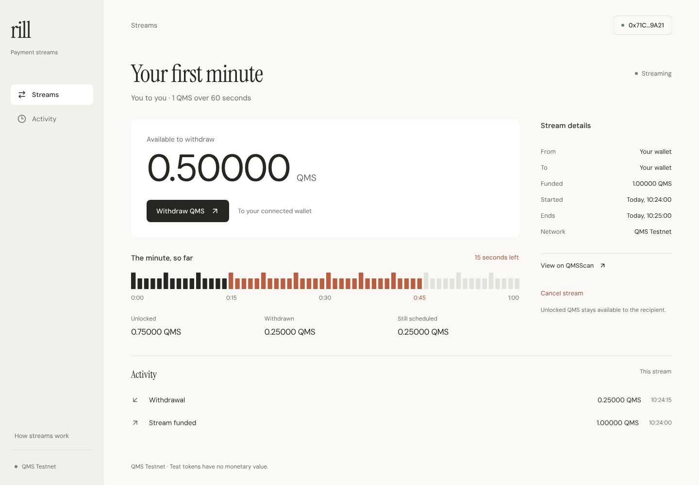

# QMS payment streaming

Two visual directions for a payment-streaming app on QMS Testnet. **Rill** is the working product name.

The planned first-use experience is a real onchain trial: stream **1 test QMS to your own wallet over 60 seconds**, then withdraw it. These screens are **design concepts with sample data**; the app and smart contracts have not been implemented yet.

## View the screens

Click any screen to see its full-resolution image. Each direction includes first visit, active stream, creation, and mobile.

| Direction A | Direction B |
| --- | --- |
| Warm, spacious, serif headings, rust accents | Dark, compact, sans-serif headings, pale green accents |
| Sidebar navigation and a dedicated stream page | Horizontal navigation and a stream list beside the details |

### First visit

| A | B |
| --- | --- |
|  |  |

### Active stream

| A | B |
| --- | --- |
|  |  |

### Create a stream

| A | B |
| --- | --- |
|  |  |

### Mobile — full page

| A | B |
| --- | --- |
|  |  |

## Editable source and notes

- [Download the editable Pen document](design/explorations.pen)
- [Design comparison and checks](design/review.md)
- [Product brief](design/brief.md)
- [Interaction requirements](design/interaction-notes.md)

Desktop exports are 1440 × 1000. Mobile exports show the full scrollable page at 390 px wide. The design source uses shared colour and typography variables, reusable navigation and buttons, and editable text and timeline elements.
