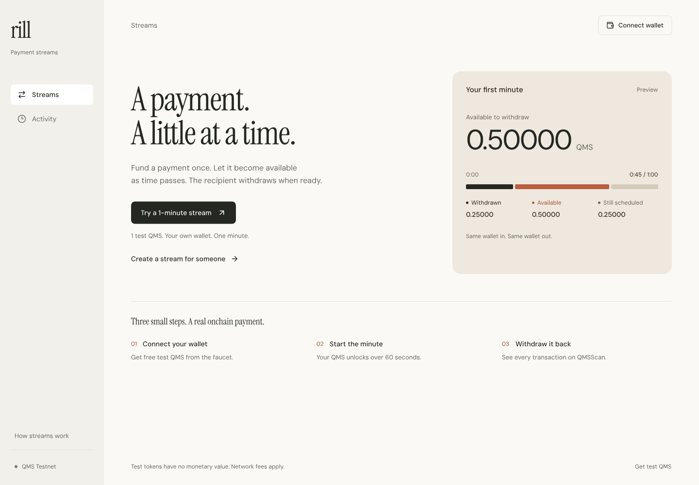
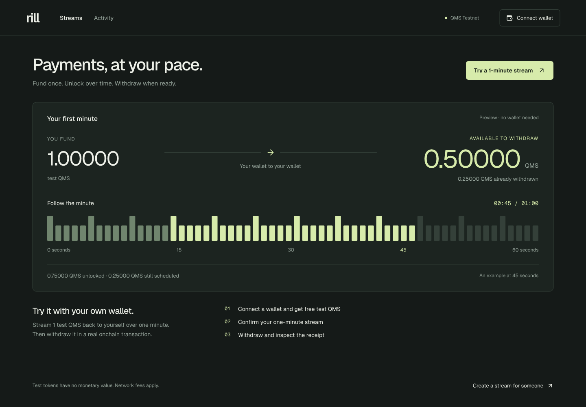
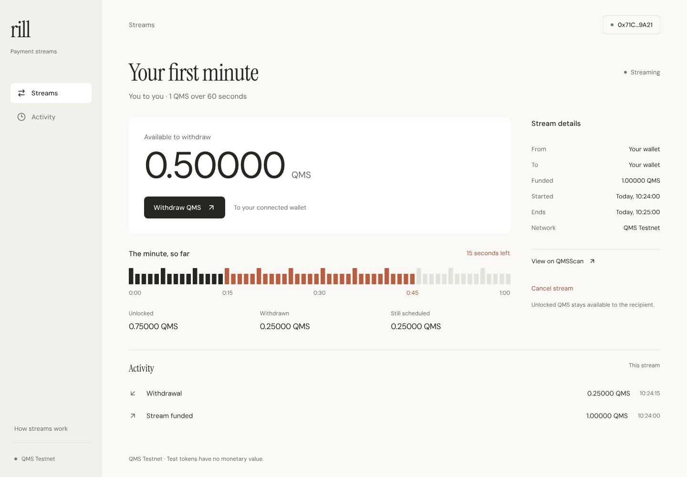
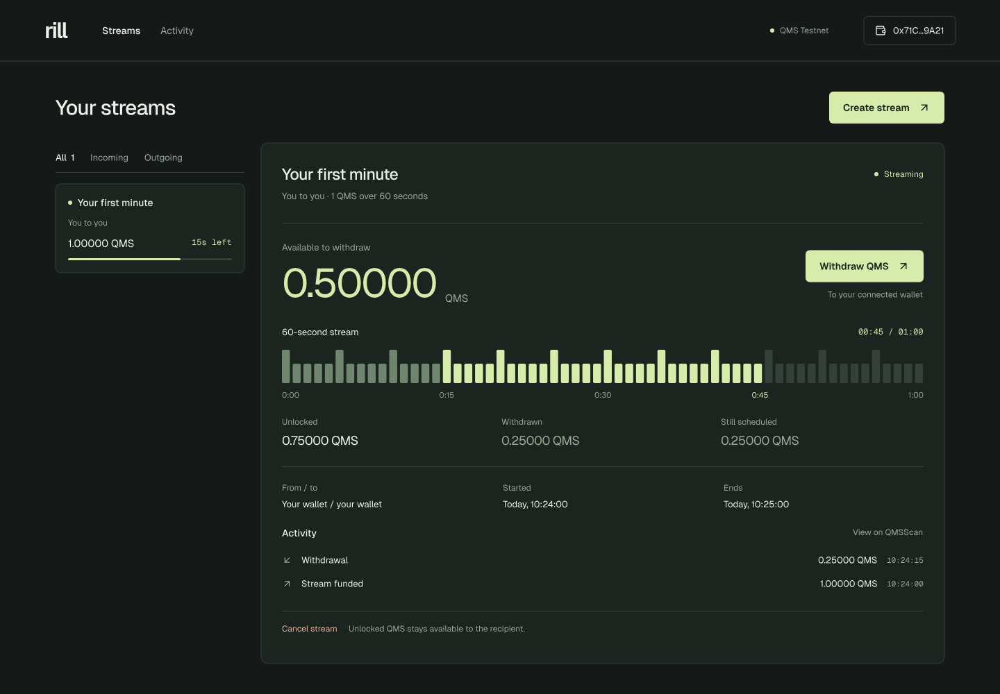
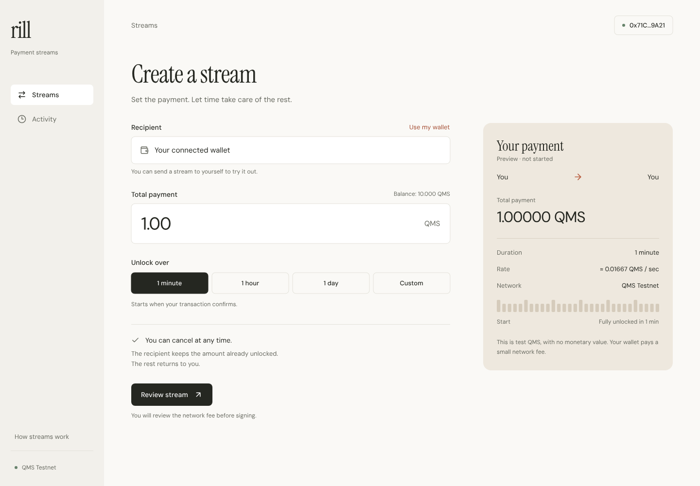
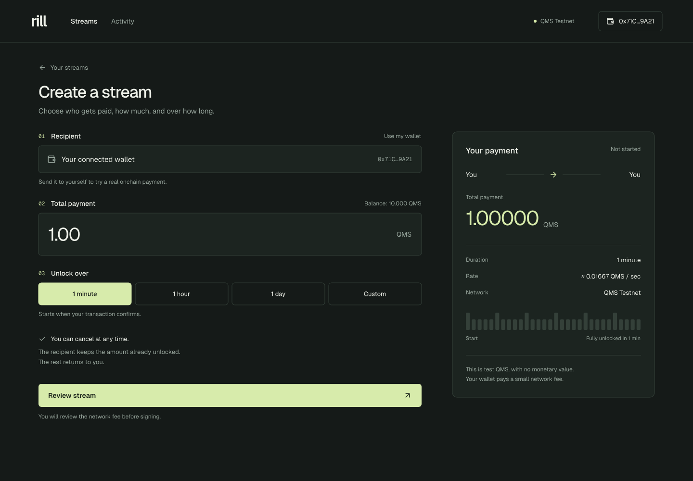
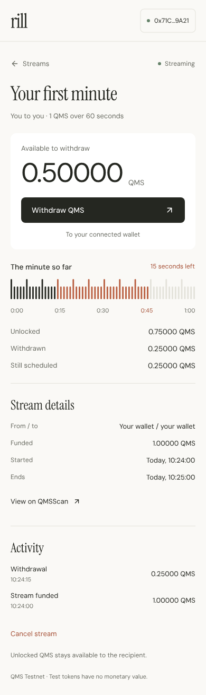
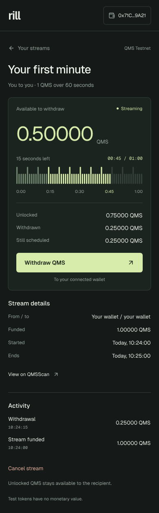

# Rill design gallery

Direction A is implemented in the app. This gallery preserves the original A/B design explorations and their editable source.

## View the screens

Click any screen to see its full-resolution image. Each direction includes first visit, active stream, creation, and mobile.

| Direction A | Direction B |
| --- | --- |
| Warm, spacious, serif headings, rust accents | Dark, compact, sans-serif headings, pale green accents |
| Sidebar navigation and a dedicated stream page | Horizontal navigation and a stream list beside the details |

### First visit

| A | B |
| --- | --- |
|  |  |

### Active stream

| A | B |
| --- | --- |
|  |  |

### Create a stream

| A | B |
| --- | --- |
|  |  |

### Mobile — full page

| A | B |
| --- | --- |
|  |  |

## Editable source and notes

- [Download the editable Pen document](explorations.pen)
- [Design comparison and checks](review.md)
- [Product brief](brief.md)
- [Interaction requirements](interaction-notes.md)

Desktop exports are 1440 × 1000. Mobile exports show the full scrollable page at 390 px wide. The design source uses shared colour and typography variables, reusable navigation and buttons, and editable text and timeline elements.
