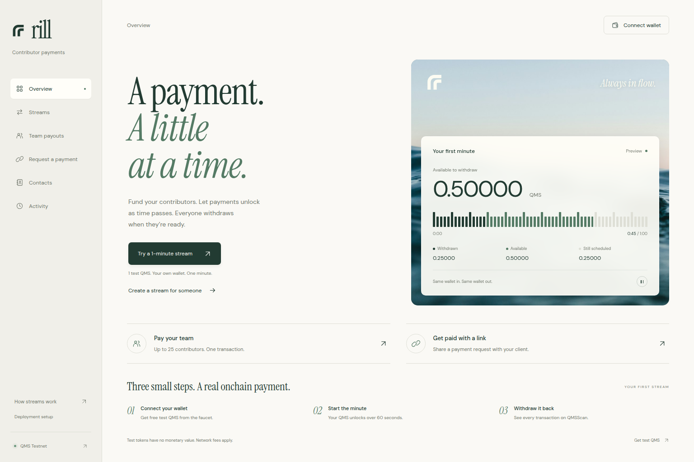
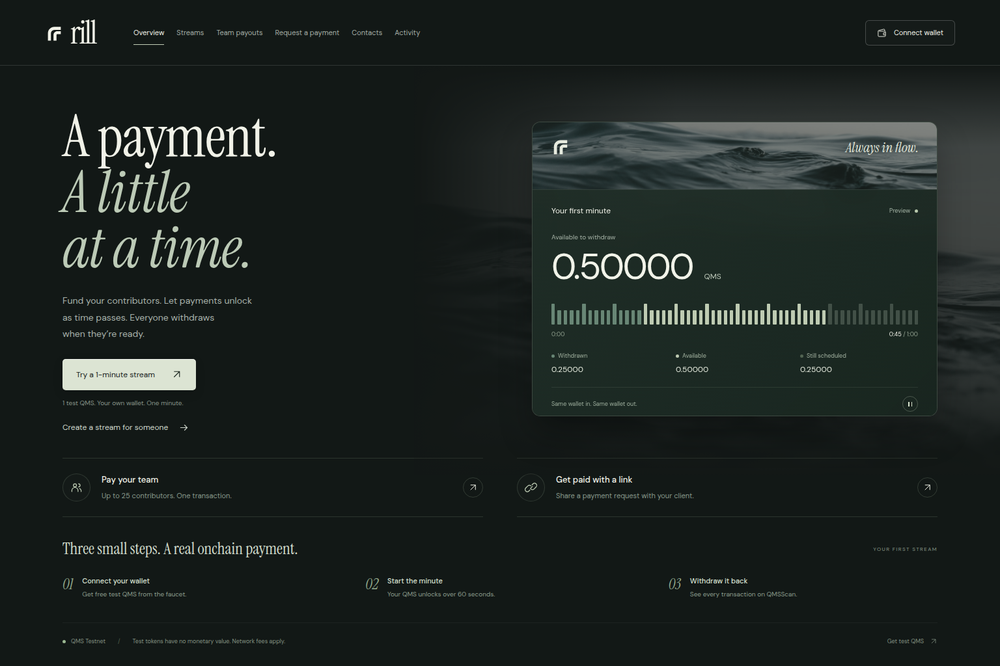

# Rill visual directions

[Open the full comparison gallery](https://rill-sepia.vercel.app/concepts/), or compare the images below. Click an image to inspect it at full size.

## A · Warm editorial

Ivory, forest green, expressive typography, and water imagery.

## B · Precision fintech

**Selected on 2026-11-10 and implemented in Rill.** Cool white, navy, sharper typography, and precise controls.

## C · Dark luxury

Deep charcoal, silver-green accents, and atmospheric depth.

## Design notes

Three static concepts prepared for the user's selection. Precision is the accepted production reference; Warm editorial and Dark luxury remain archived alternatives. The HTML artboards are editable visual references; their controls are not functional. Each PNG was rendered and visually inspected at 1536 × 1024 using Playwright Chromium. Image generation and the Browser plugin were unavailable during concepting.

| Direction | Image | Source | Proposed motion |
| --- | --- | --- | --- |
| A · Warm editorial | `warm.png` | `warm.html` | Gentle entrance sequence, flowing preview timeline, subtle image movement, soft press feedback. |
| B · Precision fintech | `precision.png` | `precision.html` | Fast transitions, precise progress updates, crisp navigation and control feedback. |
| C · Dark luxury | `dark.png` | `dark.html` | Atmospheric image movement, restrained light effects, smooth panel entrances. |

All three explore a simple double-channel “r” monogram, with different wordmark and surface treatments. The payment snapshot is illustrative: 1 QMS funded, 45 seconds elapsed, 0.25 withdrawn, 0.50 available, 0.25 scheduled. Actual financial values must remain chain-derived when the chosen direction is implemented. Motion must respect reduced-motion preferences and include pause controls for continuous previews.

The selected Precision implementation changes typography, palette, logo, preview imagery and timeline, action styling, and spacing. Core navigation and the trial action are retained. “Always in flow.” and “Your first stream” are accepted editorial copy. The working preview supports pause, resume, and replay, stops while hidden or offscreen, and respects reduced motion. The shared design system also covers the connected workspace and transaction flows. See the [implementation plan](../../docs/superpowers/plans/2026-11-10-precision-design.md).

The image is a bundled photograph from [Unsplash](https://images.unsplash.com/photo-1518837695005-2083093ee35b), under the [Unsplash license](https://unsplash.com/license). It is not AI-generated. Fonts reference the project's existing DM Sans and Instrument Serif packages. Open the HTML files from this checkout after installing the project's dependencies to retain the intended fonts.
