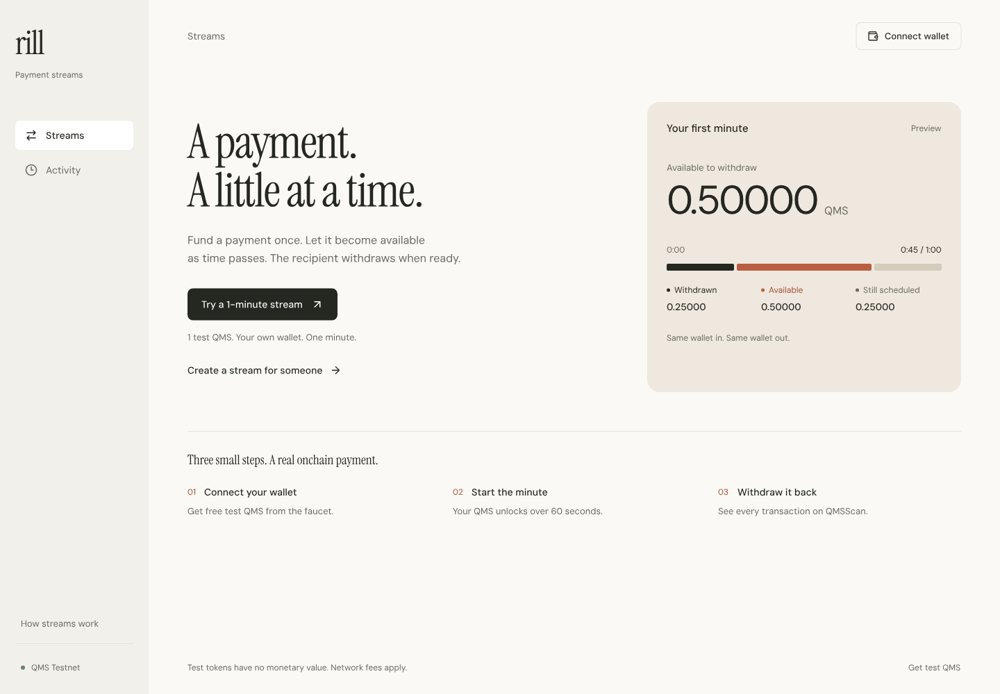
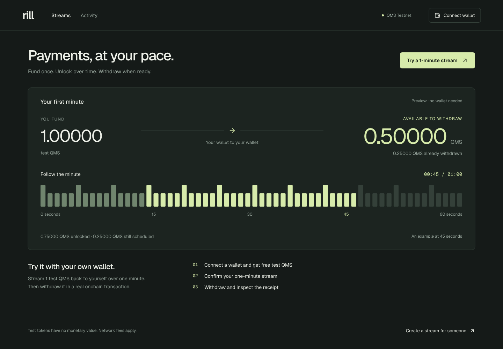

# Rill — payment streaming concepts

Two visual directions for the same QMS Testnet app. **Rill is a working name.** These are editable design concepts with consistent sample data; they do not represent a deployed contract or completed transactions.

Open `explorations.pen` in Pen to edit the screens, typography, colours, and components. The source contains a component board and eight screen frames. Each PNG below can be viewed at its original size.

## Compare the directions

| | A — light and spacious | B — dark and time-focused |
| --- | --- | --- |
| First impression | Warm background, serif headings, restrained rust accents | Charcoal surfaces, pale green accents, sans-serif headings |
| Desktop navigation | Narrow sidebar; a dedicated page for each stream | Horizontal header; stream list alongside the selected payment |
| Main emphasis | Immediately available amount, then the payment timeline | Amount and timeline as one working surface |
| Mobile | Withdrawal near the top, with details below | Timeline and balance breakdown followed by the withdrawal action |
| Best fit | A welcoming, focused introduction to payment streaming | A compact workspace for returning users managing several streams |

**Recommendation: A.** Its hierarchy gives first-time visitors a clear starting point and gives the product a distinct visual identity. Both directions support the same real onchain trial.

## Screens

| Screen | Direction A | Direction B |
| --- | --- | --- |
| First visit | [Open A](exports/a-first-visit.png) | [Open B](exports/b-first-visit.png) |
| Active stream | [Open A](exports/a-active-stream.png) | [Open B](exports/b-active-stream.png) |
| Create a stream | [Open A](exports/a-create-stream.png) | [Open B](exports/b-create-stream.png) |
| Mobile stream, full page | [Open A](exports/a-mobile.png) | [Open B](exports/b-mobile.png) |

Desktop screens are 1440 × 1000. Mobile screens are 390 px wide, with their full scrollable content shown.

### A — first visit

### B — first visit

## What has been checked

- All eight screens exported from Pen and visually inspected at their native dimensions.
- Pen's layout inspection reports no clipped child content in the screen frames.
- Static foreground/background contrast checked for 359 text nodes, including button and navigation instances; minimum ratio 4.64:1. This is a design check, not a complete browser accessibility audit.
- Deposit, unlocked, withdrawn, available, and scheduled amounts reconcile across the active screens: 1.00000 = 0.25000 withdrawn + 0.50000 available + 0.25000 scheduled.
- Creation previews are labelled as not started. Home-page illustrations are labelled as previews.
- Mobile withdrawal controls are 48 px high; back and explorer rows have 44 px height.

## Next after selection

Complete the chosen design's wallet, faucet, review, transaction, completion, and cancellation states. Then implement and verify the responsive app, the streaming contract, and the visitor's real 1-QMS / 60-second trial on QMS Testnet.

See [the product brief](brief.md) and [interaction notes](interaction-notes.md) for the intended behaviour.
